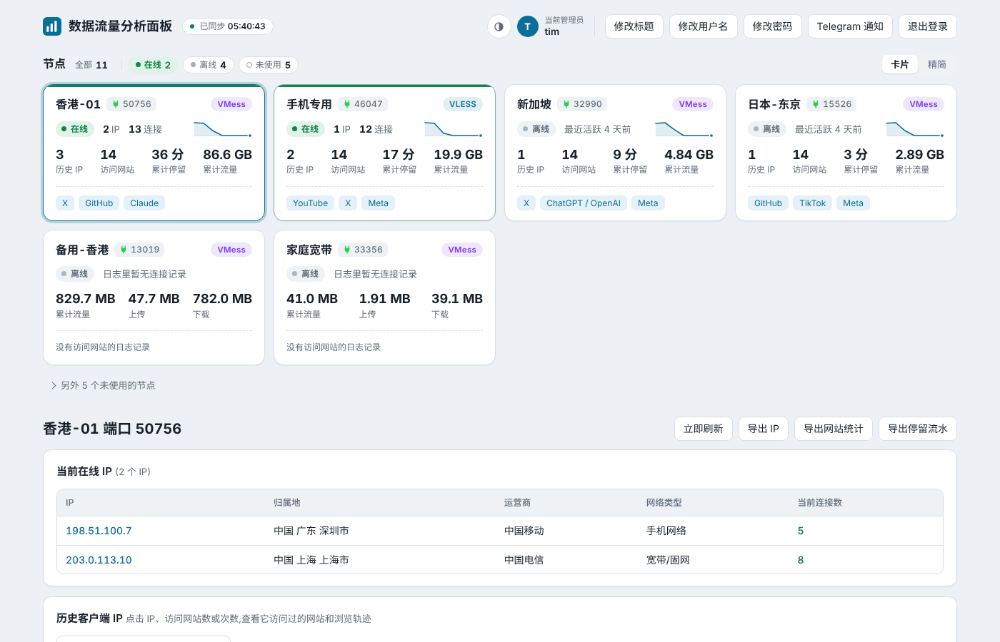
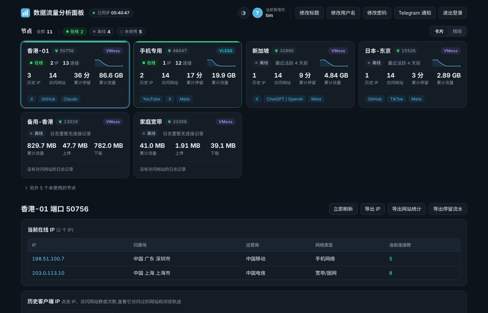
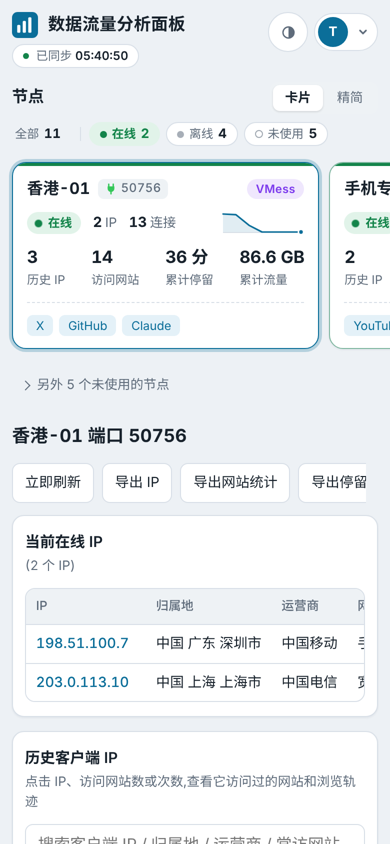
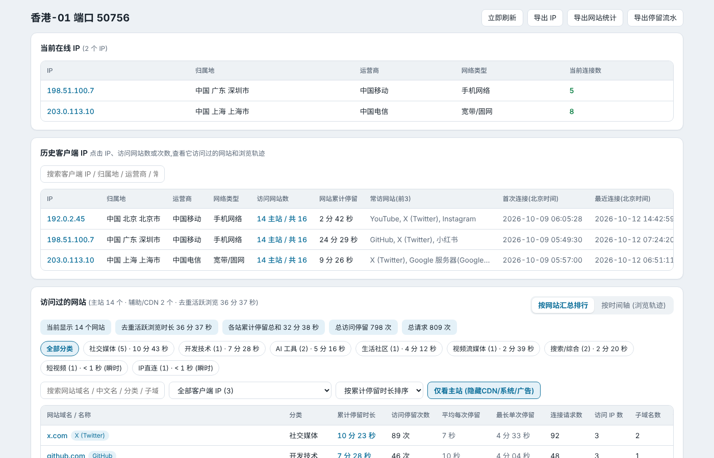
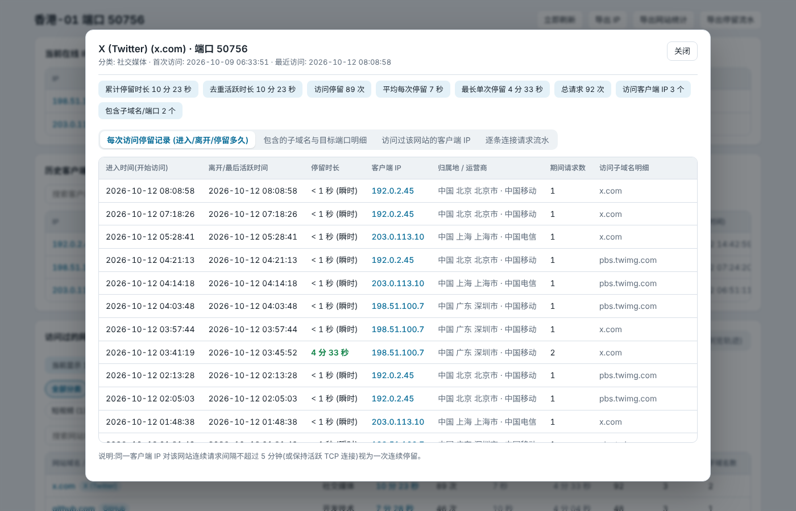
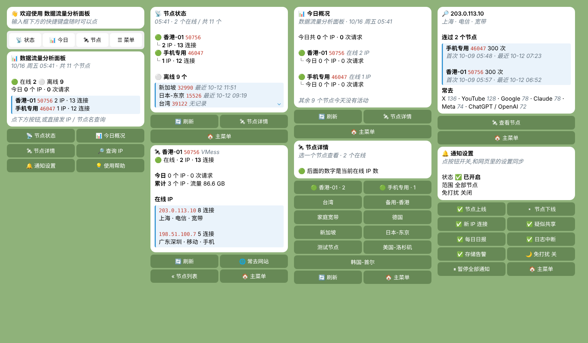

<div align="center">


# 数据流量分析面板

**配合 x-ui / 3x-ui 使用的 Xray 节点监控面板**

看清每个节点:谁在连、从哪里连、访问了哪些网站、停留了多久

[](https://github.com/wwintj/xui-xray-traffic-panel/releases)
[](LICENSE)


</div>

<p align="center">
  
</p>

## 一键安装

在装有 x-ui / 3x-ui 的 VPS 上,用 root 执行:

```bash
bash <(curl -Ls https://raw.githubusercontent.com/wwintj/xui-xray-traffic-panel/main/xray-traffic-panel.sh)
```

安装过程中会问两件事,都可以直接回车:

1. **VPS 绑定的域名**:用来通过 HTTPS 访问面板。脚本会自动从 x-ui 的面板设置里读出域名,并自动查找这个域名的证书(x-ui 面板证书、acme.sh、Let's Encrypt 都能找到)。
2. **分给面板的最大空间**:默认 10 GB,超过会自动清理最旧的数据,不会把硬盘撑满。

装完后终端会显示访问地址。默认账号 / 密码都是 **`tim`**,登录后可以在网页里修改。

> 再次运行同一条命令就是**升级**,会保留密码、端口、设置和全部历史数据。

## 功能

**节点总览**
- 自动读取 x-ui 里的全部入站,按「在线 / 离线 / 未使用」分组,在线节点排在最前面
- 每个节点显示在线 IP 数、连接数、历史 IP、访问网站数、累计停留、累计流量、近 7 天趋势和常去网站
- 卡片 / 精简两种视图;从 x-ui 删除的节点单独归档,可一键清除数据

**客户端 IP**
- 当前在线 IP 与历史 IP,附归属地、运营商(电信 / 联通 / 移动…)、网络类型(手机 / 宽带 / 机房)
- 点任意 IP 查看它访问过的网站、浏览时间轴和每一次连接

**访问网站与停留时长**
- 自动归类常见网站(YouTube、X、TikTok、小红书、ChatGPT…),并把 googlevideo、twimg 这类 CDN 域名归到对应的主站
- 只有 IP 的连接也能识别归属:内置 Google、Meta、Apple、Cloudflare 等大厂 IP 段,其余通过证书 / 反向 DNS 自动识别
- 统计每个网站的累计停留、访问次数、最长单次停留,可还原完整浏览轨迹;支持导出 CSV

**Telegram 通知与查询**
- 可选推送:节点上线 / 下线、新 IP 首次连接、疑似共享(同时在线 IP 过多)、每日日报、访问日志中断、存储空间告警
- 可指定只推送某几个节点,支持免打扰时段
- 机器人自带按钮菜单:随时查看节点状态、今日概况、节点详情;直接发 IP 或节点名即可查询

**其他**
- 浅色 / 深色 / 跟随系统,适配手机和 iPad,可「添加到主屏幕」当 App 用
- 网页里可修改标题、用户名、密码
- 总空间硬上限:数据库 + 访问日志合计不超过设定值,超出按「旧日志 → 最旧明细 → 最久没出现的 IP」顺序自动清理

## 截图

| 深色模式 | 手机 |
|---|---|
|  |  |

<details>
<summary>节点详情与网站停留记录</summary>




</details>

<details>
<summary>Telegram 机器人</summary>



</details>

## 环境要求

- Debian 10+ / Ubuntu 20.04+,root 权限
- 已安装 x-ui 或 3x-ui(默认读取 `/etc/x-ui/x-ui.db`)
- 入站建议开启**域名嗅探**(Sniffing),否则只能看到 IP,看不到具体网站域名

脚本会自动为 x-ui 开启 Xray 访问日志(修改前会备份 x-ui 数据库),无需手动配置。

## 常用操作

以下命令都可以把 `bash xray-traffic-panel.sh` 换成上面的一键安装命令。

| 操作 | 命令 |
|---|---|
| 升级 | `bash xray-traffic-panel.sh` |
| 跳过询问,直接指定域名 | `DOMAIN=panel.example.com bash xray-traffic-panel.sh` |
| 证书在特殊位置 | `DOMAIN=panel.example.com CERT_FILE=/路径/fullchain.pem KEY_FILE=/路径/key.pem bash xray-traffic-panel.sh` |
| 不用域名、关闭 HTTPS | `DOMAIN=off bash xray-traffic-panel.sh` |
| 用 IP:端口 直接访问(HTTP,不推荐) | `PUBLIC=1 bash xray-traffic-panel.sh` |
| 只允许本机 / SSH 隧道访问 | `PUBLIC=0 bash xray-traffic-panel.sh` |
| 修改空间上限 | `STORAGE_MAX_GB=20 bash xray-traffic-panel.sh` |
| 忘记密码,重置 | `ADMIN_PASS=新密码 bash xray-traffic-panel.sh` |
| 指定端口 | `PORT=8443 bash xray-traffic-panel.sh` |
| 关闭主动探测目标 IP 证书 | `IP_PROBE=0 bash xray-traffic-panel.sh` |
| 卸载(保留数据) | `bash xray-traffic-panel.sh uninstall` |

服务管理:

```bash
systemctl status xray-ip-viewer      # 运行状态
journalctl -u xray-ip-viewer -f      # 实时日志
systemctl restart xray-ip-viewer     # 重启
```

## Telegram 通知设置

1. 在 Telegram 里找 **@BotFather**,发送 `/newbot` 创建机器人,得到 Bot Token
2. 打开面板右上角的「Telegram 通知」,填入 Token
3. 给你的机器人发一条 `/start`,回到面板点「自动获取」填好 Chat ID
4. 点「发送测试消息」确认能收到,打开「启用通知」并保存

之后在 Telegram 里发 `/menu` 打开按钮菜单。机器人只回复你自己的 Chat ID。

想让机器人头像和面板一致,可以在 @BotFather 里发 `/setuserpic`,上传 [`docs/telegram-bot-avatar.png`](docs/telegram-bot-avatar.png)。

## 常见问题

<details>
<summary>某个节点明明有人用,面板里却没有数据?</summary>

- 先确认 x-ui 的 Xray 访问日志是开着的:`tail /var/log/xray/access.log` 应该能看到持续有新内容。如果没有,重新运行一次安装脚本即可自动开启。
- 面板只能统计**开启日志之后**的连接。
- 新版 Xray 的很多日志行不带入站标签,面板会通过实时连接表(`ss`)把它们归到正确的节点,首次安装后几秒内就会生效。
</details>

<details>
<summary>为什么网站列表里很多是 IP,不是域名?</summary>

客户端自己解析了 DNS、直接连 IP 时,服务器上只能看到 IP。面板会尽量识别 IP 属于哪家(Google、Meta、Cloudflare…)。想看到具体域名,可以:

- 在 x-ui 的入站里开启**嗅探**(Sniffing);
- 或者让客户端把域名交给服务器解析(例如 Clash 的 fake-ip 模式)。
</details>

<details>
<summary>显示的归属地和我实际的网络不一样?</summary>

面板显示的是**连到服务器的那个 IP** 的归属地。如果中间有中转、前置代理,或者手机其实连着 Wi-Fi,看到的就不是手机本身的运营商。
</details>

<details>
<summary>用了 Cloudflare 代理(橙色云)打不开?</summary>

Cloudflare 只代理部分端口:443、2053、2083、2087、2096、8443。脚本会优先选这些端口。SSL 模式请选 **Full (strict)**。
</details>

<details>
<summary>数据会越来越大吗?</summary>

不会超过安装时设定的上限(默认 10 GB)。平时逐条明细保留 30 天、停留记录保留 90 天,节点和 IP 的汇总长期保留。页面底部可以看到当前占用。
</details>

## 隐私说明

这个面板会记录并展示每个连接用户访问过的网站和停留时长。如果你的节点有其他人在用,请确认你有权这样做,并事先告知对方。

另外请注意:

- IP 归属地通过 [ip-api.com](https://ip-api.com) 的免费接口查询,会把客户端 IP 发送给第三方。
- 识别 IP 属于哪个网站时,面板会主动连接目标 IP 的 443 端口读取证书。如果不需要,可以用 `IP_PROBE=0 bash xray-traffic-panel.sh` 重新运行一次关闭,以后升级会保持关闭。

## 协议

[MIT](LICENSE)
